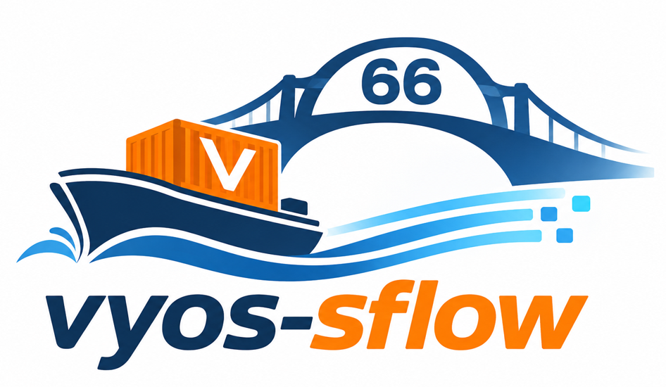
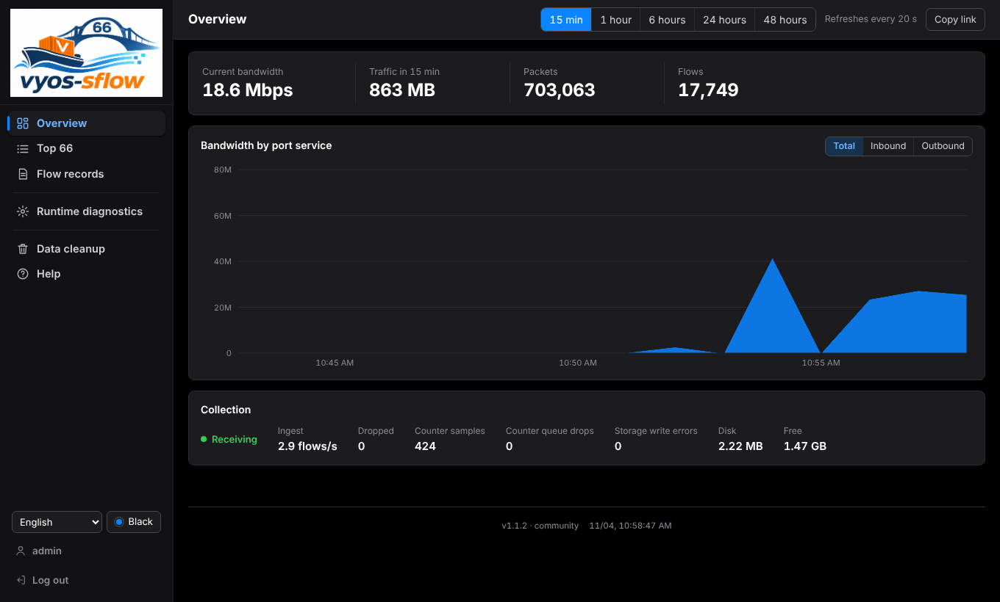
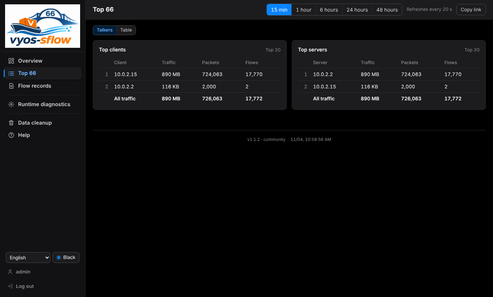
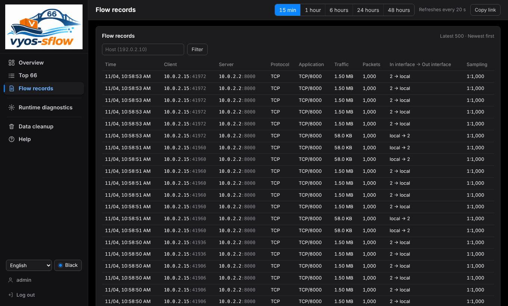
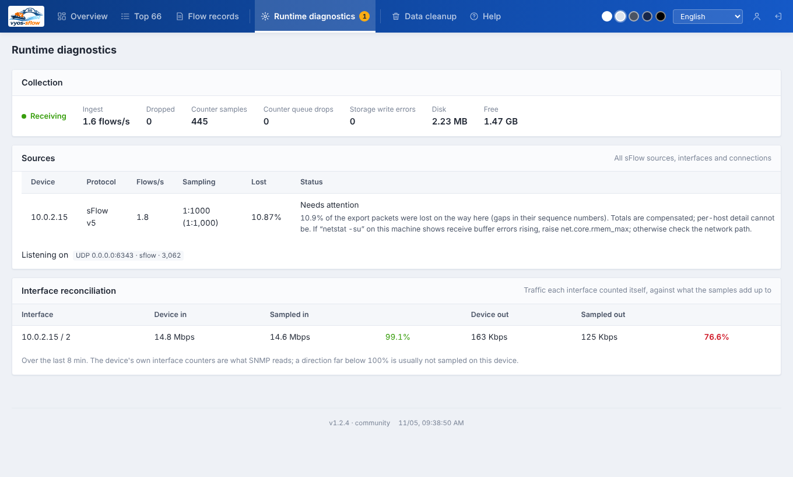
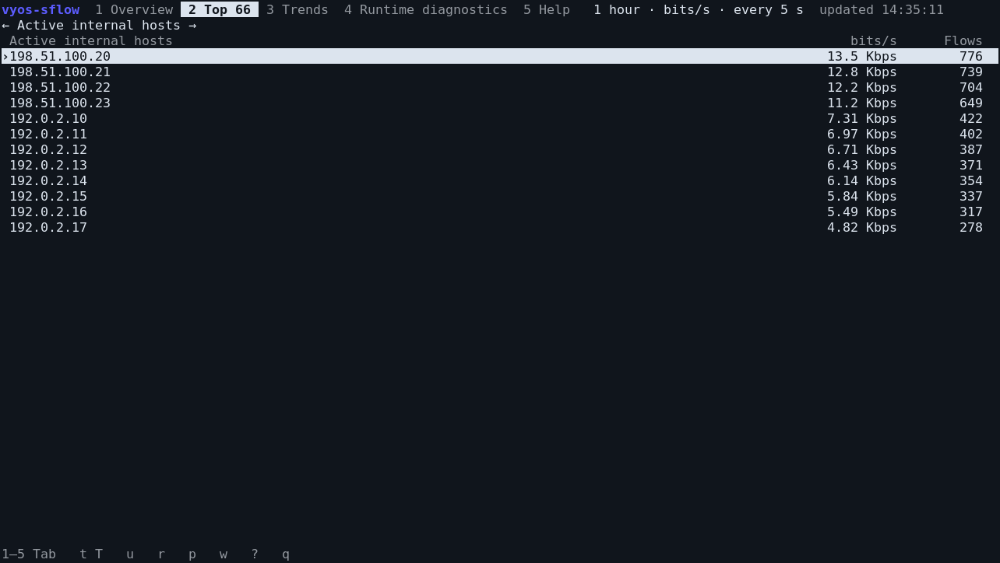

<p align="center">
  
</p>

# vyos-sflow

Local sFlow traffic analysis for VyOS and Linux. View bandwidth, top talkers and recent flow records in your browser or over SSH.

[Quick start](#get-started-in-3-steps) · [Terminal view](#temporary-terminal-view-tui) · [Screenshots](#screenshots) · [User manual](docs/MANUAL.md) · [Service installation](docs/VYOS.md)

| Feature | Details |
| --- | --- |
| Web | Bandwidth, interface traffic from the device’s own counters, client/server rankings and flow records; five themes from light to dark |
| TUI | One command for a temporary view over SSH |
| History | The latest 48 hours, stored with DuckDB™ |
| UI text | 15 interface languages |
| Build | Linux amd64, including VyOS |

## Get started in 3 steps

### 1. Enable traffic sampling

Connect to the router over SSH. Replace `eth0` with the interface you want to monitor and `ROUTER_IP` with that interface's IPv4 address. Find it with `ip -4 addr show dev eth0`. Skip this step if sFlow already sends to `127.0.0.1:6343`.

```sh
configure
set system sflow interface eth0
set system sflow agent-address ROUTER_IP
set system sflow sampling-rate 1000
set system sflow polling 30
set system sflow server 127.0.0.1 port 6343
commit
save
exit
```

### 2. Download and run

In a writable directory on the router:

```sh
curl -fLO https://github.com/githubflyideas/vyos-sflow/releases/download/v1.2.6/vyos-sflow-1.2.6-linux-amd64.tar.gz &&
curl -fLO https://github.com/githubflyideas/vyos-sflow/releases/download/v1.2.6/SHA256SUMS &&
sha256sum --ignore-missing -c SHA256SUMS &&
tar -xzf vyos-sflow-1.2.6-linux-amd64.tar.gz &&
cd vyos-sflow-1.2.6-linux-amd64 &&
./vyos-sflow serve
```

At the Web address prompt, type this router's private LAN IP (for example `192.168.1.1`) to open the dashboard from your network. Press **Enter** to keep it on this machine only (`127.0.0.1`); type `0.0.0.0` only if you really want every interface. Without a terminal (scripts, pipes) there is no prompt and the Web UI stays on `127.0.0.1`.

### 3. Open the dashboard

Open **`http://ROUTER_IP:8066`** in your browser, using the IP you typed. If you kept `127.0.0.1`, first open an SSH tunnel on your computer with `ssh -N -L 8066:127.0.0.1:8066 SSH_USER@ROUTER_IP`, then open `http://127.0.0.1:8066`. Sign in with **`admin` / `tryvyossflow66`**, change the password, then open **Overview** or **Top**. Charts fill as sampled traffic arrives; **Sources** helps diagnose an empty chart.

**Stop and restart:** keep this terminal or SSH session open while running. Press `Ctrl+C` to stop; run `./vyos-sflow serve` from the same directory to continue. Accounts and history are stored in `./vyso_sflow_data` — keep this folder. (The spelling `vyso` is historical and kept on purpose so existing data is found after an upgrade.)

> [!WARNING]
> The Web UI (TCP `8066`) listens on `127.0.0.1` unless you choose an address at the prompt or with `-addr`/`VYOS_SFLOW_ADDR`. sFlow UDP `6343` listens on all interfaces so exporters on other hosts can reach it; when the exporter is this router, use `-listen 127.0.0.1:6343`, otherwise restrict UDP with your firewall. Change the default password before exposing the Web UI anywhere. HTTP is unencrypted; [TLS is optional](docs/VYOS.md). Releases up to 1.2.5 bound the Web UI to all interfaces by default; see the [changelog](CHANGELOG.md).

## Temporary terminal view (TUI)

For a quick look over SSH, run one command:

```sh
./vyos-sflow tui
```

- **No local service running:** starts a temporary sFlow collector and opens the terminal dashboard. No separate `serve` command, browser or service installation is needed.
- **Local service already running:** connects to it using its local credentials instead of starting a second collector.
- **Quit with `q` or `Ctrl+C`:** closes the TUI and any temporary collector it started. An existing service keeps running.

Standalone TUI history lasts only for that session. Its temporary data is removed on exit; existing accounts and `./vyso_sflow_data` are not cleared. Keep using `serve` or the optional system service when you want continuous collection and persistent history.

Press `?` for keyboard help. For an explicitly selected service, use `-url http://ROUTER_IP:8066 -user admin`; the password is prompted without echoing. Explicit connection options never start a replacement collector if the connection fails.

## Reading the numbers

| View | What the numbers mean |
| --- | --- |
| Overview | Top indicators cover all traffic in the selected range. Inbound/outbound chart directions are relative to the displayed exporter and interface, not automatically a WAN link. Interface traffic comes from the device’s own interface counters (the same values SNMP reads). |
| Top 66 | The top 30 clients and top 30 servers are two perspectives on the same traffic. Roles are inferred; do not add the two lists together. The all-traffic total also includes entries outside the ranking. |
| Flow records | The newest records first, 100 to a page, over at most 24 hours, even with a global 48-hour selection. The page shows the effective window. The estimated multiplier is the measured effective sampling rate; it is not the router's configured sampling ratio. |
| Diagnostics | Interface reconciliation compares each interface’s own counters with what the samples add up to; a direction far from 100% is usually not sampled on the device. |

## Screenshots

These captures show the application running, rather than UI mockups.

### Web dashboard

Native VyOS capture of v1.2.4: the router's own sFlow samples real downloads at 1 in 1000, on a VyOS 2026.10.30 rolling live ISO in a VM. Nothing is mocked or edited; the VM loses some sFlow packets on receipt, which the diagnostics page reports.



<details>
<summary>View client/server rankings, flow records and interface reconciliation</summary>

**Client and server rankings**



**Recent flow records**



**Interface reconciliation**




</details>

### Terminal UI

A real Linux terminal running v1.1.2 with synthetic sFlow sent to the collector:



## Optional setup

Want automatic startup? [Install as a service](docs/VYOS.md). Otherwise, keep running the executable directly.

[Configuration](docs/VYOS.md) · [User manual](docs/MANUAL.md) · [Compatibility and validation](docs/VALIDATION.md)

## License and trademarks

vyos-sflow is licensed under the **[Apache License 2.0](LICENSE)**. Keep the [NOTICE](NOTICE) file with redistributions. vyos-sflow is derived from [Traffic66](https://github.com/githubflyideas/traffic66) by the same copyright holder; the license files inherited from Traffic66 in earlier commits have been replaced by Apache-2.0. [upstream-manifest.json](upstream-manifest.json) is a historical provenance record of the upstream files at the time of derivation, including those former license files; its hashes are intentionally left unchanged.

The license does not grant trademark rights. The names "vyos-sflow" and "Traffic66" and the project logo are reserved; see [TRADEMARKS.md](TRADEMARKS.md). Third-party licenses and notices are listed in [THIRD_PARTY_NOTICES.md](THIRD_PARTY_NOTICES.md).

**DuckDB is a trademark of the DuckDB Foundation.** This project uses DuckDB as its embedded database. It is not an official DuckDB product and is not affiliated with, sponsored by or endorsed by the DuckDB Foundation. DuckDB is distributed under the MIT license; software licenses do not grant rights to DuckDB trademarks or logos.
