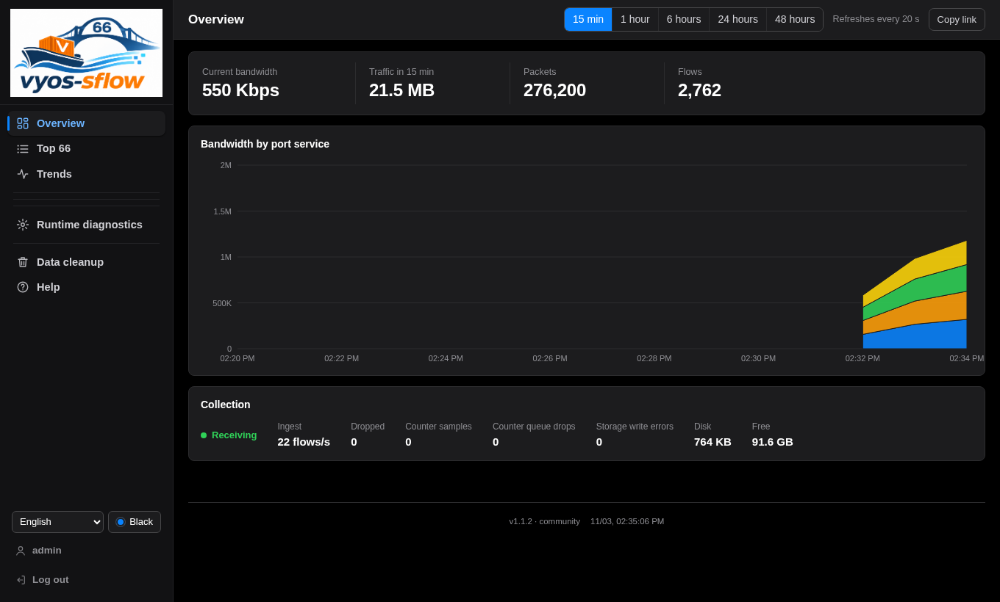
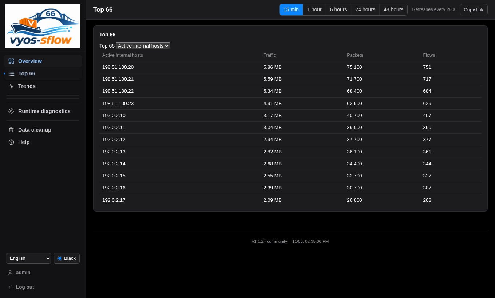

<p align="center">
  
</p>

# vyos-sflow

Your VyOS traffic at a glance: **live trends, Top IPs, ports and protocols**, with **48 hours of local history** powered by DuckDB™. Use the **Web dashboard** in a browser or the **terminal UI (TUI)** over SSH. Available in 15 languages.

## Get started in 3 steps

### 1. Enable traffic sampling

Connect to the router over SSH. Replace `eth0` with the interface you want to monitor and `ROUTER_IP` with that interface's IPv4 address. Find it with `ip -4 addr show dev eth0`. Skip this step if sFlow already sends to `127.0.0.1:6343`.

```sh
configure
set system sflow interface eth0
set system sflow agent-address ROUTER_IP
set system sflow sampling-rate 1000
set system sflow polling 30
set system sflow server 127.0.0.1 port 6343
commit
save
exit
```

### 2. Download and run

In a writable directory on the router:

```sh
curl -fLO https://github.com/githubflyideas/vyos-sflow-new/releases/download/v1.1.2/vyos-sflow-1.1.2-linux-amd64.tar.gz &&
curl -fLO https://github.com/githubflyideas/vyos-sflow-new/releases/download/v1.1.2/SHA256SUMS &&
sha256sum --ignore-missing -c SHA256SUMS &&
tar -xzf vyos-sflow-1.1.2-linux-amd64.tar.gz &&
cd vyos-sflow-1.1.2-linux-amd64 &&
./vyos-sflow serve
```

Press **Enter** at the Web IP prompt to use all interfaces, or enter a private IP of this machine.

### 3. Open the dashboard

Open **`http://ROUTER_IP:8066`** in your browser. Sign in with **`admin` / `tryvyossflow66`**, change the password, then open **Overview** or **Top**. Charts fill as sampled traffic arrives; **Sources** helps diagnose an empty chart.

**Stop and restart:** keep this terminal or SSH session open while running. Press `Ctrl+C` to stop; run `./vyos-sflow serve` from the same directory to continue. Accounts and history are stored in `./vyso_sflow_data` — keep this folder.

**Keep it private:** Web TCP `8066` and sFlow UDP `6343` listen on all interfaces by default. Restrict them to trusted networks before logging in. HTTP is unencrypted; optional TLS configuration is in the [installation guide](docs/VYOS.md).

## Temporary terminal view (TUI)

For a quick look over SSH, run one command:

```sh
./vyos-sflow tui
```

- **No local service running:** starts a temporary sFlow collector and opens the terminal dashboard. No separate `serve` command, browser or service installation is needed.
- **Local service already running:** connects to it using its local credentials instead of starting a second collector.
- **Quit with `q` or `Ctrl+C`:** closes the TUI and any temporary collector it started. An existing service keeps running.

Standalone TUI history lasts only for that session. Its temporary data is removed on exit; existing accounts and `./vyso_sflow_data` are not cleared. Keep using `serve` or the optional system service when you want continuous collection and persistent history.

Press `?` for keyboard help. For an explicitly selected service, use `-url http://ROUTER_IP:8066 -user admin`; the password is prompted without echoing. Explicit connection options never start a replacement collector if the connection fails.

## Screenshots

Actual **v1.1.2** screens, captured from the released Linux executable. The demonstration traffic is synthetic sFlow sent through the real UDP collector, storage and API—not mocked responses or edited screen contents.

### Web dashboard

Live traffic, recent history and collection health:



### Top hosts

Traffic rankings from the same collection session:



### Terminal UI

The real TUI running in a Linux terminal, connected to the same service:


## Optional setup

Want automatic startup? [Install as a service](docs/VYOS.md). Otherwise, keep running the executable directly.

[Configuration](docs/VYOS.md) · [User manual](docs/MANUAL.md) · [Compatibility and validation](docs/VALIDATION.md)

## License and DuckDB trademark

**Apache License 2.0** — see [LICENSE](LICENSE). Third-party licenses and notices are listed in [THIRD_PARTY_NOTICES.md](THIRD_PARTY_NOTICES.md).

**DuckDB is a trademark of the DuckDB Foundation.** This project uses DuckDB as its embedded database. It is not an official DuckDB product and is not affiliated with, sponsored by or endorsed by the DuckDB Foundation. DuckDB is distributed under the MIT license; software licenses do not grant rights to DuckDB trademarks or logos.
